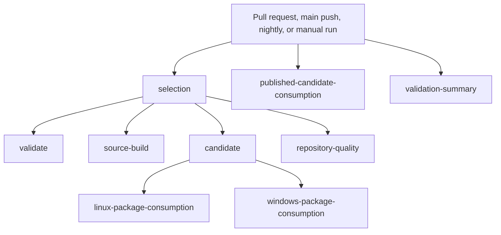

# Library architecture

Domain primitives and provider-neutral contracts depend inward. Provider modules own reusable integrations and their external dependencies. Consumers own business rules, authentication policy, schemas, migrations, application composition, and deployment.

The library has no application AppHost or deployment topology. These diagrams are generated from this checkout's project references and workflow jobs. Refresh them with `dotnet run --project tools/SharedKernel.Documentation.Tool -c Release -- generate --config docs/architecture/generated-diagrams.json`; detect drift with `dotnet run --project tools/SharedKernel.Documentation.Tool -c Release -- verify --config docs/architecture/generated-diagrams.json`.

## Library project dependencies

Node labels use project/assembly identities; public C# namespace roots are `PandaBear.*`.

<!-- generated:library-dependencies:start -->
<!-- Generated by tools/SharedKernel.Documentation.Tool. Do not edit by hand. -->

```mermaid
flowchart TB
    SharedKernel_ApiVersioning_AspNetCore[SharedKernel.ApiVersioning.AspNetCore] --> SharedKernel_ApiVersioning[SharedKernel.ApiVersioning]
    SharedKernel_AspNetCore[SharedKernel.AspNetCore] --> SharedKernel_InputNormalization[SharedKernel.InputNormalization]
    SharedKernel_AspNetCore_Authentication[SharedKernel.AspNetCore.Authentication] --> SharedKernel_AspNetCore[SharedKernel.AspNetCore]
    SharedKernel_AspNetCore_Authentication[SharedKernel.AspNetCore.Authentication] --> SharedKernel_OpenApi[SharedKernel.OpenApi]
    SharedKernel_AspNetCore_Localization[SharedKernel.AspNetCore.Localization] --> SharedKernel_BuildingBlocks[SharedKernel.BuildingBlocks]
    SharedKernel_AspNetCore_RateLimiting[SharedKernel.AspNetCore.RateLimiting] --> SharedKernel_AspNetCore[SharedKernel.AspNetCore]
    SharedKernel_AspNetCore_Seo[SharedKernel.AspNetCore.Seo] --> SharedKernel_BuildingBlocks[SharedKernel.BuildingBlocks]
    SharedKernel_AspNetCore_WebAnalytics[SharedKernel.AspNetCore.WebAnalytics] --> SharedKernel_AspNetCore[SharedKernel.AspNetCore]
    SharedKernel_Aspire_Hosting[SharedKernel.Aspire.Hosting] --> SharedKernel_AspNetCore[SharedKernel.AspNetCore]
    SharedKernel_Aspire_Hosting_Umami[SharedKernel.Aspire.Hosting.Umami] --> SharedKernel_Aspire_Hosting[SharedKernel.Aspire.Hosting]
    SharedKernel_Blazor[SharedKernel.Blazor] --> SharedKernel_HttpClients[SharedKernel.HttpClients]
    SharedKernel_Blazor[SharedKernel.Blazor] --> SharedKernel_Results[SharedKernel.Results]
    SharedKernel_Blazor_Site[SharedKernel.Blazor.Site] --> SharedKernel_BuildingBlocks[SharedKernel.BuildingBlocks]
    SharedKernel_Blazor_Site[SharedKernel.Blazor.Site] --> SharedKernel_InputNormalization[SharedKernel.InputNormalization]
    SharedKernel_Branding[SharedKernel.Branding] --> SharedKernel_InputNormalization[SharedKernel.InputNormalization]
    SharedKernel_Branding[SharedKernel.Branding] --> SharedKernel_Results[SharedKernel.Results]
    SharedKernel_BuildingBlocks[SharedKernel.BuildingBlocks] --> SharedKernel_InputNormalization[SharedKernel.InputNormalization]
    SharedKernel_BuildingBlocks[SharedKernel.BuildingBlocks] --> SharedKernel_Results[SharedKernel.Results]
    SharedKernel_CI[SharedKernel.CI] --> SharedKernel_ConfigurationFiles[SharedKernel.ConfigurationFiles]
    SharedKernel_CI[SharedKernel.CI] --> SharedKernel_IO[SharedKernel.IO]
    SharedKernel_CI[SharedKernel.CI] --> SharedKernel_InputNormalization[SharedKernel.InputNormalization]
    SharedKernel_CI[SharedKernel.CI] --> SharedKernel_Processes[SharedKernel.Processes]
    SharedKernel_CI[SharedKernel.CI] --> SharedKernel_Versioning[SharedKernel.Versioning]
    SharedKernel_CI_Forgejo[SharedKernel.CI.Forgejo] --> SharedKernel_CI[SharedKernel.CI]
    SharedKernel_CI_Forgejo[SharedKernel.CI.Forgejo] --> SharedKernel_Forgejo[SharedKernel.Forgejo]
    SharedKernel_CI_GitHub[SharedKernel.CI.GitHub] --> SharedKernel_CI[SharedKernel.CI]
    SharedKernel_CI_GitHub[SharedKernel.CI.GitHub] --> SharedKernel_GitHub[SharedKernel.GitHub]
    SharedKernel_ConfigurationFiles[SharedKernel.ConfigurationFiles] --> SharedKernel_IO[SharedKernel.IO]
    SharedKernel_DevContainers[SharedKernel.DevContainers] --> SharedKernel_InputNormalization[SharedKernel.InputNormalization]
    SharedKernel_DevContainers[SharedKernel.DevContainers] --> SharedKernel_Processes[SharedKernel.Processes]
    SharedKernel_DispositionHold_EntityFrameworkCore[SharedKernel.DispositionHold.EntityFrameworkCore] --> SharedKernel_BuildingBlocks[SharedKernel.BuildingBlocks]
    SharedKernel_DispositionHold_EntityFrameworkCore[SharedKernel.DispositionHold.EntityFrameworkCore] --> SharedKernel_DispositionHold_Abstractions[SharedKernel.DispositionHold.Abstractions]
    SharedKernel_DispositionHold_EntityFrameworkCore[SharedKernel.DispositionHold.EntityFrameworkCore] --> SharedKernel_EntityFrameworkCore[SharedKernel.EntityFrameworkCore]
    SharedKernel_DispositionHold_EntityFrameworkCore[SharedKernel.DispositionHold.EntityFrameworkCore] --> SharedKernel_Npgsql[SharedKernel.Npgsql]
    SharedKernel_DocumentRendering[SharedKernel.DocumentRendering] --> SharedKernel_InputNormalization[SharedKernel.InputNormalization]
    SharedKernel_Domain[SharedKernel.Domain] --> SharedKernel_BuildingBlocks[SharedKernel.BuildingBlocks]
    SharedKernel_Domain_EntityFrameworkCore[SharedKernel.Domain.EntityFrameworkCore] --> SharedKernel_Domain[SharedKernel.Domain]
    SharedKernel_Domain_EntityFrameworkCore[SharedKernel.Domain.EntityFrameworkCore] --> SharedKernel_EntityFrameworkCore[SharedKernel.EntityFrameworkCore]
    SharedKernel_EntityFrameworkCore[SharedKernel.EntityFrameworkCore] --> SharedKernel_BuildingBlocks[SharedKernel.BuildingBlocks]
    SharedKernel_EntityFrameworkCore_Npgsql[SharedKernel.EntityFrameworkCore.Npgsql] --> SharedKernel_EntityFrameworkCore[SharedKernel.EntityFrameworkCore]
    SharedKernel_EntityFrameworkCore_Sqlite[SharedKernel.EntityFrameworkCore.Sqlite] --> SharedKernel_EntityFrameworkCore[SharedKernel.EntityFrameworkCore]
    SharedKernel_EventSourcing_Npgsql[SharedKernel.EventSourcing.Npgsql] --> SharedKernel_BuildingBlocks[SharedKernel.BuildingBlocks]
    SharedKernel_EventSourcing_Npgsql[SharedKernel.EventSourcing.Npgsql] --> SharedKernel_EventSourcing[SharedKernel.EventSourcing]
    SharedKernel_EventSourcing_Npgsql[SharedKernel.EventSourcing.Npgsql] --> SharedKernel_Npgsql[SharedKernel.Npgsql]
    SharedKernel_Forgejo[SharedKernel.Forgejo] --> SharedKernel_Processes[SharedKernel.Processes]
    SharedKernel_GitHub[SharedKernel.GitHub] --> SharedKernel_Processes[SharedKernel.Processes]
    SharedKernel_HttpClients[SharedKernel.HttpClients] --> SharedKernel_Idempotency_Abstractions[SharedKernel.Idempotency.Abstractions]
    SharedKernel_Idempotency_AspNetCore[SharedKernel.Idempotency.AspNetCore] --> SharedKernel_Idempotency_Abstractions[SharedKernel.Idempotency.Abstractions]
    SharedKernel_Idempotency_AspNetCore[SharedKernel.Idempotency.AspNetCore] --> SharedKernel_Results[SharedKernel.Results]
    SharedKernel_Idempotency_EntityFrameworkCore[SharedKernel.Idempotency.EntityFrameworkCore] --> SharedKernel_EntityFrameworkCore[SharedKernel.EntityFrameworkCore]
    SharedKernel_Idempotency_EntityFrameworkCore[SharedKernel.Idempotency.EntityFrameworkCore] --> SharedKernel_Idempotency_Abstractions[SharedKernel.Idempotency.Abstractions]
    SharedKernel_IntegrationTesting[SharedKernel.IntegrationTesting] --> SharedKernel_Testing_Xunit[SharedKernel.Testing.Xunit]
    SharedKernel_LoadTesting[SharedKernel.LoadTesting] --> SharedKernel_ConfigurationFiles[SharedKernel.ConfigurationFiles]
    SharedKernel_LoadTesting[SharedKernel.LoadTesting] --> SharedKernel_IO[SharedKernel.IO]
    SharedKernel_LoadTesting[SharedKernel.LoadTesting] --> SharedKernel_Processes[SharedKernel.Processes]
    SharedKernel_LoadTesting_K6[SharedKernel.LoadTesting.K6] --> SharedKernel_LoadTesting[SharedKernel.LoadTesting]
    SharedKernel_LoadTesting_K6[SharedKernel.LoadTesting.K6] --> SharedKernel_Processes[SharedKernel.Processes]
    SharedKernel_MalwareScanning_ClamAv[SharedKernel.MalwareScanning.ClamAv] --> SharedKernel_MalwareScanning[SharedKernel.MalwareScanning]
    SharedKernel_MalwareScanning_ClamAv[SharedKernel.MalwareScanning.ClamAv] --> SharedKernel_OpenApi[SharedKernel.OpenApi]
    SharedKernel_Mediator[SharedKernel.Mediator] --> SharedKernel_BuildingBlocks[SharedKernel.BuildingBlocks]
    SharedKernel_Mediator[SharedKernel.Mediator] --> SharedKernel_Mediator_Abstractions[SharedKernel.Mediator.Abstractions]
    SharedKernel_Mediator[SharedKernel.Mediator] --> SharedKernel_Results[SharedKernel.Results]
    SharedKernel_Mediator_EntityFrameworkCore[SharedKernel.Mediator.EntityFrameworkCore] --> SharedKernel_EntityFrameworkCore[SharedKernel.EntityFrameworkCore]
    SharedKernel_Mediator_EntityFrameworkCore[SharedKernel.Mediator.EntityFrameworkCore] --> SharedKernel_Mediator_Abstractions[SharedKernel.Mediator.Abstractions]
    SharedKernel_Mediator_EntityFrameworkCore[SharedKernel.Mediator.EntityFrameworkCore] --> SharedKernel_Npgsql[SharedKernel.Npgsql]
    SharedKernel_Mediator_EntityFrameworkCore[SharedKernel.Mediator.EntityFrameworkCore] --> SharedKernel_Results[SharedKernel.Results]
    SharedKernel_Messaging_IntegrationEvents[SharedKernel.Messaging.IntegrationEvents] --> SharedKernel_Messaging[SharedKernel.Messaging]
    SharedKernel_Messaging_IntegrationEvents_CloudEvents[SharedKernel.Messaging.IntegrationEvents.CloudEvents] --> SharedKernel_Messaging_IntegrationEvents[SharedKernel.Messaging.IntegrationEvents]
    SharedKernel_Messaging_IntegrationEvents_EntityFrameworkCore[SharedKernel.Messaging.IntegrationEvents.EntityFrameworkCore] --> SharedKernel_EntityFrameworkCore[SharedKernel.EntityFrameworkCore]
    SharedKernel_Messaging_IntegrationEvents_EntityFrameworkCore[SharedKernel.Messaging.IntegrationEvents.EntityFrameworkCore] --> SharedKernel_Idempotency_EntityFrameworkCore[SharedKernel.Idempotency.EntityFrameworkCore]
    SharedKernel_Messaging_IntegrationEvents_EntityFrameworkCore[SharedKernel.Messaging.IntegrationEvents.EntityFrameworkCore] --> SharedKernel_Messaging[SharedKernel.Messaging]
    SharedKernel_Messaging_IntegrationEvents_EntityFrameworkCore[SharedKernel.Messaging.IntegrationEvents.EntityFrameworkCore] --> SharedKernel_Messaging_IntegrationEvents[SharedKernel.Messaging.IntegrationEvents]
    SharedKernel_Messaging_IntegrationEvents_EntityFrameworkCore[SharedKernel.Messaging.IntegrationEvents.EntityFrameworkCore] --> SharedKernel_Scheduling[SharedKernel.Scheduling]
    SharedKernel_Messaging_Protobuf[SharedKernel.Messaging.Protobuf] --> SharedKernel_Messaging_IntegrationEvents[SharedKernel.Messaging.IntegrationEvents]
    SharedKernel_ObjectStorage[SharedKernel.ObjectStorage] --> SharedKernel_InputNormalization[SharedKernel.InputNormalization]
    SharedKernel_ObjectStorage_S3[SharedKernel.ObjectStorage.S3] --> SharedKernel_InputNormalization[SharedKernel.InputNormalization]
    SharedKernel_ObjectStorage_S3[SharedKernel.ObjectStorage.S3] --> SharedKernel_ObjectStorage[SharedKernel.ObjectStorage]
    SharedKernel_OpenApi[SharedKernel.OpenApi] --> SharedKernel_ApiVersioning[SharedKernel.ApiVersioning]
    SharedKernel_Packages[SharedKernel.Packages] --> SharedKernel_BuildingBlocks[SharedKernel.BuildingBlocks]
    SharedKernel_Packages[SharedKernel.Packages] --> SharedKernel_ConfigurationFiles[SharedKernel.ConfigurationFiles]
    SharedKernel_Packages[SharedKernel.Packages] --> SharedKernel_Processes[SharedKernel.Processes]
    SharedKernel_Packages[SharedKernel.Packages] --> SharedKernel_Results[SharedKernel.Results]
    SharedKernel_PlaywrightMcp[SharedKernel.PlaywrightMcp] --> SharedKernel_Processes[SharedKernel.Processes]
    SharedKernel_Repositories[SharedKernel.Repositories] --> SharedKernel_ConfigurationFiles[SharedKernel.ConfigurationFiles]
    SharedKernel_Repositories[SharedKernel.Repositories] --> SharedKernel_IO[SharedKernel.IO]
    SharedKernel_Repositories[SharedKernel.Repositories] --> SharedKernel_InputNormalization[SharedKernel.InputNormalization]
    SharedKernel_Repositories[SharedKernel.Repositories] --> SharedKernel_Processes[SharedKernel.Processes]
    SharedKernel_Repositories_Forgejo[SharedKernel.Repositories.Forgejo] --> SharedKernel_Forgejo[SharedKernel.Forgejo]
    SharedKernel_Repositories_Forgejo[SharedKernel.Repositories.Forgejo] --> SharedKernel_IO[SharedKernel.IO]
    SharedKernel_Repositories_Forgejo[SharedKernel.Repositories.Forgejo] --> SharedKernel_Repositories[SharedKernel.Repositories]
    SharedKernel_Repositories_GitHub[SharedKernel.Repositories.GitHub] --> SharedKernel_GitHub[SharedKernel.GitHub]
    SharedKernel_Repositories_GitHub[SharedKernel.Repositories.GitHub] --> SharedKernel_IO[SharedKernel.IO]
    SharedKernel_Repositories_GitHub[SharedKernel.Repositories.GitHub] --> SharedKernel_InputNormalization[SharedKernel.InputNormalization]
    SharedKernel_Repositories_GitHub[SharedKernel.Repositories.GitHub] --> SharedKernel_Processes[SharedKernel.Processes]
    SharedKernel_Repositories_GitHub[SharedKernel.Repositories.GitHub] --> SharedKernel_Repositories[SharedKernel.Repositories]
    SharedKernel_Results[SharedKernel.Results] --> SharedKernel_Results_SourceGenerator[SharedKernel.Results.SourceGenerator]
    SharedKernel_Results_AspNet[SharedKernel.Results.AspNet] --> SharedKernel_Results[SharedKernel.Results]
    SharedKernel_Sandbox[SharedKernel.Sandbox] --> SharedKernel_ConfigurationFiles[SharedKernel.ConfigurationFiles]
    SharedKernel_Sandbox[SharedKernel.Sandbox] --> SharedKernel_IO[SharedKernel.IO]
    SharedKernel_Sandbox[SharedKernel.Sandbox] --> SharedKernel_InputNormalization[SharedKernel.InputNormalization]
    SharedKernel_Sandbox_ClaudeCode[SharedKernel.Sandbox.ClaudeCode] --> SharedKernel_IO[SharedKernel.IO]
    SharedKernel_Sandbox_ClaudeCode[SharedKernel.Sandbox.ClaudeCode] --> SharedKernel_Sandbox[SharedKernel.Sandbox]
    SharedKernel_SecretScanning[SharedKernel.SecretScanning] --> SharedKernel_BuildingBlocks[SharedKernel.BuildingBlocks]
    SharedKernel_SecretScanning[SharedKernel.SecretScanning] --> SharedKernel_Encodings[SharedKernel.Encodings]
    SharedKernel_Secrets[SharedKernel.Secrets] --> SharedKernel_BuildingBlocks[SharedKernel.BuildingBlocks]
    SharedKernel_Secrets[SharedKernel.Secrets] --> SharedKernel_ConfigurationFiles[SharedKernel.ConfigurationFiles]
    SharedKernel_Secrets[SharedKernel.Secrets] --> SharedKernel_Encodings[SharedKernel.Encodings]
    SharedKernel_Secrets[SharedKernel.Secrets] --> SharedKernel_IO[SharedKernel.IO]
    SharedKernel_Secrets[SharedKernel.Secrets] --> SharedKernel_InputNormalization[SharedKernel.InputNormalization]
    SharedKernel_Secrets[SharedKernel.Secrets] --> SharedKernel_Processes[SharedKernel.Processes]
    SharedKernel_Secrets[SharedKernel.Secrets] --> SharedKernel_Results[SharedKernel.Results]
    SharedKernel_Secrets_Age[SharedKernel.Secrets.Age] --> SharedKernel_Processes[SharedKernel.Processes]
    SharedKernel_Secrets_Age[SharedKernel.Secrets.Age] --> SharedKernel_Secrets[SharedKernel.Secrets]
    SharedKernel_Secrets_Sops[SharedKernel.Secrets.Sops] --> SharedKernel_Processes[SharedKernel.Processes]
    SharedKernel_Secrets_Sops[SharedKernel.Secrets.Sops] --> SharedKernel_Secrets[SharedKernel.Secrets]
    SharedKernel_ServiceDefaults[SharedKernel.ServiceDefaults] --> SharedKernel_Observability[SharedKernel.Observability]
    SharedKernel_Style_CodeFixes[SharedKernel.Style.CodeFixes] --> SharedKernel_Style_Analyzers[SharedKernel.Style.Analyzers]
    SharedKernel_Tabular[SharedKernel.Tabular] --> SharedKernel_Results[SharedKernel.Results]
    SharedKernel_Testing[SharedKernel.Testing] --> SharedKernel_Testing_SourceGenerator[SharedKernel.Testing.SourceGenerator]
    SharedKernel_Testing_AspNetCore[SharedKernel.Testing.AspNetCore] --> SharedKernel_Testing_Xunit[SharedKernel.Testing.Xunit]
    SharedKernel_Testing_Assertions[SharedKernel.Testing.Assertions] --> SharedKernel_Results[SharedKernel.Results]
    SharedKernel_Testing_CodeFixes[SharedKernel.Testing.CodeFixes] --> SharedKernel_Testing_Analyzers[SharedKernel.Testing.Analyzers]
    SharedKernel_Testing_Domain[SharedKernel.Testing.Domain] --> SharedKernel_Domain[SharedKernel.Domain]
    SharedKernel_Testing_Http[SharedKernel.Testing.Http] --> SharedKernel_Testing_Assertions[SharedKernel.Testing.Assertions]
    SharedKernel_Testing_MalwareScanning[SharedKernel.Testing.MalwareScanning] --> SharedKernel_MalwareScanning[SharedKernel.MalwareScanning]
    SharedKernel_Testing_Mediator[SharedKernel.Testing.Mediator] --> SharedKernel_Mediator_Abstractions[SharedKernel.Mediator.Abstractions]
    SharedKernel_Testing_Messaging[SharedKernel.Testing.Messaging] --> SharedKernel_Messaging[SharedKernel.Messaging]
    SharedKernel_Testing_Messaging[SharedKernel.Testing.Messaging] --> SharedKernel_Messaging_IntegrationEvents[SharedKernel.Messaging.IntegrationEvents]
    SharedKernel_Testing_ObjectStorage[SharedKernel.Testing.ObjectStorage] --> SharedKernel_ObjectStorage[SharedKernel.ObjectStorage]
    SharedKernel_Testing_Playwright[SharedKernel.Testing.Playwright] --> SharedKernel_Testing_AspNetCore[SharedKernel.Testing.AspNetCore]
    SharedKernel_Testing_Xunit[SharedKernel.Testing.Xunit] --> SharedKernel_Testing[SharedKernel.Testing]
    SharedKernel_UploadSanitizing[SharedKernel.UploadSanitizing] --> SharedKernel_Results[SharedKernel.Results]
    SharedKernel_Vault[SharedKernel.Vault] --> SharedKernel_BuildingBlocks[SharedKernel.BuildingBlocks]
    SharedKernel_Vault[SharedKernel.Vault] --> SharedKernel_Encodings[SharedKernel.Encodings]
    SharedKernel_Vault[SharedKernel.Vault] --> SharedKernel_IO[SharedKernel.IO]
    SharedKernel_Vault[SharedKernel.Vault] --> SharedKernel_InputNormalization[SharedKernel.InputNormalization]
    SharedKernel_Vault[SharedKernel.Vault] --> SharedKernel_SecretScanning[SharedKernel.SecretScanning]
    SharedKernel_Vault_Bitwarden[SharedKernel.Vault.Bitwarden] --> SharedKernel_Vault[SharedKernel.Vault]
    SharedKernel_Vault_Keeper[SharedKernel.Vault.Keeper] --> SharedKernel_Vault[SharedKernel.Vault]
    SharedKernel_Versioning[SharedKernel.Versioning] --> SharedKernel_IO[SharedKernel.IO]
    SharedKernel_Versioning[SharedKernel.Versioning] --> SharedKernel_Processes[SharedKernel.Processes]
```
<!-- generated:library-dependencies:end -->

## Hosted validation

<!-- generated:library-ci:start -->
<!-- Generated by tools/SharedKernel.Documentation.Tool. Do not edit by hand. -->


<!-- generated:library-ci:end -->
