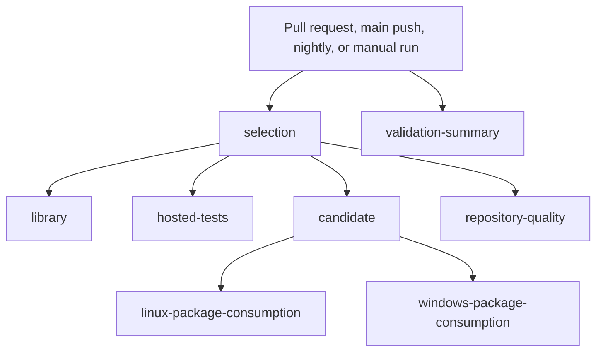

# Library architecture

Domain primitives and provider-neutral contracts depend inward. Provider modules own reusable integrations and their external dependencies. Consumers own business rules, authentication policy, schemas, migrations, application composition, and deployment.

The library has no application AppHost or deployment topology. These diagrams are generated from this checkout's project references and workflow jobs. Refresh them with `dotnet run --project tools/SharedKernel.Documentation.Tool -c Release -- generate --config docs/architecture/generated-diagrams.json`; detect drift with `dotnet run --project tools/SharedKernel.Documentation.Tool -c Release -- verify --config docs/architecture/generated-diagrams.json`.

## Library project dependencies

Node labels use unchanged project/assembly identities; public C# namespace roots are `PandaBear.*`.

```mermaid
flowchart TB
    SharedKernel_ApiVersioning_AspNetCore[SharedKernel.ApiVersioning.AspNetCore] --> SharedKernel_ApiVersioning[SharedKernel.ApiVersioning]
    SharedKernel_AspNetCore[SharedKernel.AspNetCore] --> SharedKernel_Idempotency[SharedKernel.Idempotency]
    SharedKernel_AspNetCore[SharedKernel.AspNetCore] --> SharedKernel_InputNormalization[SharedKernel.InputNormalization]
    SharedKernel_AspNetCore[SharedKernel.AspNetCore] --> SharedKernel_OpenApi[SharedKernel.OpenApi]
    SharedKernel_AspNetCore[SharedKernel.AspNetCore] --> SharedKernel_Results[SharedKernel.Results]
    SharedKernel_Branding[SharedKernel.Branding] --> SharedKernel_HttpClients[SharedKernel.HttpClients]
    SharedKernel_Branding[SharedKernel.Branding] --> SharedKernel_InputNormalization[SharedKernel.InputNormalization]
    SharedKernel_Branding[SharedKernel.Branding] --> SharedKernel_Results[SharedKernel.Results]
    SharedKernel_BuildingBlocks[SharedKernel.BuildingBlocks] --> SharedKernel_Results[SharedKernel.Results]
    SharedKernel_DocumentRendering[SharedKernel.DocumentRendering] --> SharedKernel_InputNormalization[SharedKernel.InputNormalization]
    SharedKernel_Domain[SharedKernel.Domain] --> SharedKernel_BuildingBlocks[SharedKernel.BuildingBlocks]
    SharedKernel_Domain_EntityFrameworkCore[SharedKernel.Domain.EntityFrameworkCore] --> SharedKernel_Domain[SharedKernel.Domain]
    SharedKernel_Domain_EntityFrameworkCore[SharedKernel.Domain.EntityFrameworkCore] --> SharedKernel_EntityFrameworkCore[SharedKernel.EntityFrameworkCore]
    SharedKernel_EventSourcing_Npgsql[SharedKernel.EventSourcing.Npgsql] --> SharedKernel_BuildingBlocks[SharedKernel.BuildingBlocks]
    SharedKernel_EventSourcing_Npgsql[SharedKernel.EventSourcing.Npgsql] --> SharedKernel_EventSourcing[SharedKernel.EventSourcing]
    SharedKernel_EventSourcing_Npgsql[SharedKernel.EventSourcing.Npgsql] --> SharedKernel_Npgsql[SharedKernel.Npgsql]
    SharedKernel_Idempotency_EntityFrameworkCore[SharedKernel.Idempotency.EntityFrameworkCore] --> SharedKernel_EntityFrameworkCore[SharedKernel.EntityFrameworkCore]
    SharedKernel_Idempotency_EntityFrameworkCore[SharedKernel.Idempotency.EntityFrameworkCore] --> SharedKernel_Idempotency[SharedKernel.Idempotency]
    SharedKernel_MalwareScanning_ClamAv[SharedKernel.MalwareScanning.ClamAv] --> SharedKernel_MalwareScanning[SharedKernel.MalwareScanning]
    SharedKernel_MalwareScanning_ClamAv[SharedKernel.MalwareScanning.ClamAv] --> SharedKernel_OpenApi[SharedKernel.OpenApi]
    SharedKernel_Mediator[SharedKernel.Mediator] --> SharedKernel_Mediator_Abstractions[SharedKernel.Mediator.Abstractions]
    SharedKernel_Mediator_EntityFrameworkCore[SharedKernel.Mediator.EntityFrameworkCore] --> SharedKernel_EntityFrameworkCore[SharedKernel.EntityFrameworkCore]
    SharedKernel_Mediator_EntityFrameworkCore[SharedKernel.Mediator.EntityFrameworkCore] --> SharedKernel_Mediator_Abstractions[SharedKernel.Mediator.Abstractions]
    SharedKernel_Messaging_IntegrationEvents[SharedKernel.Messaging.IntegrationEvents] --> SharedKernel_Messaging[SharedKernel.Messaging]
    SharedKernel_Messaging_IntegrationEvents_CloudEvents[SharedKernel.Messaging.IntegrationEvents.CloudEvents] --> SharedKernel_Messaging_IntegrationEvents[SharedKernel.Messaging.IntegrationEvents]
    SharedKernel_Messaging_IntegrationEvents_EntityFrameworkCore[SharedKernel.Messaging.IntegrationEvents.EntityFrameworkCore] --> SharedKernel_EntityFrameworkCore[SharedKernel.EntityFrameworkCore]
    SharedKernel_Messaging_IntegrationEvents_EntityFrameworkCore[SharedKernel.Messaging.IntegrationEvents.EntityFrameworkCore] --> SharedKernel_Idempotency_EntityFrameworkCore[SharedKernel.Idempotency.EntityFrameworkCore]
    SharedKernel_Messaging_IntegrationEvents_EntityFrameworkCore[SharedKernel.Messaging.IntegrationEvents.EntityFrameworkCore] --> SharedKernel_Messaging[SharedKernel.Messaging]
    SharedKernel_Messaging_IntegrationEvents_EntityFrameworkCore[SharedKernel.Messaging.IntegrationEvents.EntityFrameworkCore] --> SharedKernel_Messaging_IntegrationEvents[SharedKernel.Messaging.IntegrationEvents]
    SharedKernel_Messaging_IntegrationEvents_EntityFrameworkCore[SharedKernel.Messaging.IntegrationEvents.EntityFrameworkCore] --> SharedKernel_Scheduling[SharedKernel.Scheduling]
    SharedKernel_OpenApi[SharedKernel.OpenApi] --> SharedKernel_ApiVersioning[SharedKernel.ApiVersioning]
    SharedKernel_Results[SharedKernel.Results] --> SharedKernel_Results_SourceGenerator[SharedKernel.Results.SourceGenerator]
    SharedKernel_Results_AspNet[SharedKernel.Results.AspNet] --> SharedKernel_Results[SharedKernel.Results]
    SharedKernel_Style_CodeFixes[SharedKernel.Style.CodeFixes] --> SharedKernel_Style_Analyzers[SharedKernel.Style.Analyzers]
    SharedKernel_Tabular[SharedKernel.Tabular] --> SharedKernel_Results[SharedKernel.Results]
    SharedKernel_Testing_CodeFixes[SharedKernel.Testing.CodeFixes] --> SharedKernel_Testing_Analyzers[SharedKernel.Testing.Analyzers]
    SharedKernel_Testing_Mediator[SharedKernel.Testing.Mediator] --> SharedKernel_Mediator_Abstractions[SharedKernel.Mediator.Abstractions]
```

<!-- generated:library-dependencies:start -->
<!-- Generated by tools/SharedKernel.Documentation.Tool. Do not edit by hand. -->

<!-- generated:library-dependencies:end -->

## Hosted validation

<!-- generated:library-ci:start -->
<!-- Generated by tools/SharedKernel.Documentation.Tool. Do not edit by hand. -->

<!-- generated:library-ci:end -->
